# Exhaustive Production-Grade WebSockets Masterclass: From Beginner to Staff Real-Time Systems Architect

[](https://github.com/manthanank/learn-websockets/actions)
[](https://opensource.org/licenses/MIT)
[](https://datatracker.ietf.org/doc/html/rfc6455)
[](CONTRIBUTING.md)

Welcome to the definitive, production-grade masterclass on **WebSockets, Real-Time Networking, and High-Throughput Event Streaming Systems**. This guide is engineered for backend developers, distributed systems architects, full-stack engineers, and site reliability engineers (SREs). It spans from low-level RFC 6455 TCP frame bitmasking and SHA-1 handshake hashing to multi-node Redis adapter scaling, heartbeat state machines, mitigating Cross-Site WebSocket Hijacking (CSWSH), and tuning Linux OS kernel parameters for millions of concurrent active socket connections ($C1000K$).

---

## Table of Contents
1. [Stage 1: Real-Time Protocols & Network Transport Fundamentals](#1-stage-1-real-time-protocols--network-transport-fundamentals)
   - 1.1 The Evolution of Web Communication: Polling, Long-Polling, SSE, and WebSockets
   - 1.2 WebSockets vs WebTransport (HTTP/3 QUIC)
   - 1.3 The HTTP Upgrade Handshake (`101 Switching Protocols`)
   - 1.4 Cryptographic Handshake Verification: SHA-1 & `Sec-WebSocket-Accept`
2. [Stage 2: RFC 6455 Framing & Binary Protocol Wire Mechanics](#2-stage-2-rfc-6455-framing--binary-protocol-wire-mechanics)
   - 2.1 Anatomy of a WebSocket Frame (FIN, RSV, Opcode, Mask, Payload)
   - 2.2 Client-to-Server Masking and 4-Byte XOR Bitwise Transformation
   - 2.3 Variable Payload Length Encoding (7-bit, 16-bit, 64-bit)
   - 2.4 Data Frames vs Control Frames: Fragmentation & Interleaving Rules
3. [Stage 3: Server & Client Architecture: Raw `ws` vs Socket.io](#3-stage-3-server--client-architecture-raw-ws-vs-socketio)
   - 3.1 High-Performance Native Node.js `ws` Implementation
   - 3.2 Handshake Authentication & JWT Verification
   - 3.3 Socket.io Architectural Abstraction: Engine.IO, Rooms, and Namespaces
   - 3.4 Resilient Browser Client Implementation with Modern Web APIs
4. [Stage 4: Reliability, Heartbeats & Resilient Reconnection](#4-stage-4-reliability-heartbeats--resilient-reconnection)
   - 4.1 The Silent Connection Drop: TCP Half-Open State & NAT Timeouts
   - 4.2 Heartbeat State Machine: Ping/Pong Frame Protocol
   - 4.3 Exponential Backoff with Jitter Reconnection Engine
   - 4.4 Offline Message Queuing & Sequence Number Reconciliation
5. [Stage 5: Horizontal Scaling & Distributed State Management](#5-stage-5-horizontal-scaling--distributed-state-management)
   - 5.1 The Single-Server Trap & Multi-Node Cluster Topologies
   - 5.2 Redis Pub/Sub and Streams Cluster Adapter
   - 5.3 Load Balancing Real-Time Traffic: Sticky Sessions with NGINX & AWS ALB
   - 5.4 Externalizing Socket Session State to Distributed Key-Value Stores
6. [Stage 6: Enterprise Security, Rate Limiting & DoS Mitigation](#6-stage-6-enterprise-security-rate-limiting--dos-mitigation)
   - 6.1 Cross-Site WebSocket Hijacking (CSWSH) & Origin Validation
   - 6.2 Token Bucket Rate Limiting per Active Socket
   - 6.3 Slowloris, Frame Flooding & Buffer Exhaustion Protection
   - 6.4 TLS Termination & Hardened `wss://` Deployment
7. [Stage 7: Staff Real-Time & Network Systems Architect Interview Handbook](#7-stage-7-staff-real-time--network-systems-architect-interview-handbook)
   - 7.1 High-Stakes Production Outages & Architectural Post-Mortems
   - 7.2 25 Exhaustive Technical Interview Questions & Answers
8. [Community, Contributing & Support](#8-community-contributing--support)

---

## 1. Stage 1: Real-Time Protocols & Network Transport Fundamentals

### 1.1 The Evolution of Web Communication: Polling, Long-Polling, SSE, and WebSockets
Early web applications relied on request-response patterns that struggled with real-time requirements:

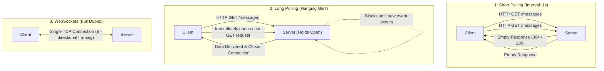

| Transport Method | Latency | Header Overhead | Server Resource Impact | Directionality |
| :--- | :--- | :--- | :--- | :--- |
| **Short Polling** | High (polling interval) | Huge (~1KB HTTP headers every request) | High CPU & thread waste | Simplex (Client requests) |
| **Long Polling** | Medium | High (new headers per message) | Connection thread starvation | Simplex (Emulated push) |
| **Server-Sent Events** | Low | Low (HTTP chunked streaming) | Low | Simplex (Server $	o$ Client) |
| **WebSockets** | Ultra-Low (<2ms) | 2–10 bytes per frame | Minimal (persistent socket) | **Full-Duplex (Bidirectional)** |

### 1.2 WebSockets vs WebTransport (HTTP/3 QUIC)
While WebSockets run over reliable, ordered **TCP**, head-of-line blocking can occur if a single packet is dropped. **WebTransport** (built on HTTP/3 and QUIC over UDP) introduces multiplexed streams and unreliable datagrams:

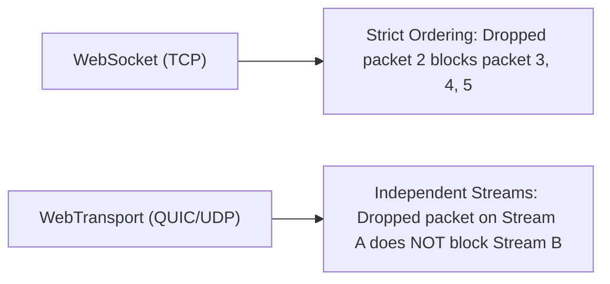

| Dimension | WebSockets (RFC 6455) | WebTransport (W3C / IETF) |
| :--- | :--- | :--- |
| **Transport Layer** | TCP | QUIC (UDP) |
| **Handshake** | HTTP/1.1 Upgrade | HTTP/3 CONNECT |
| **Head-of-Line Blocking** | Yes (Single TCP stream) | No (Independent QUIC streams) |
| **Unreliable Datagrams** | Not Supported | Supported (Ideal for gaming/voice) |
| **Browser Support** | 99.8% Global Adoption | Emerging (Chrome, Edge) |

### 1.3 The HTTP Upgrade Handshake (`101 Switching Protocols`)
Every WebSocket connection begins life as a standard HTTP/1.1 request containing specific upgrade headers:

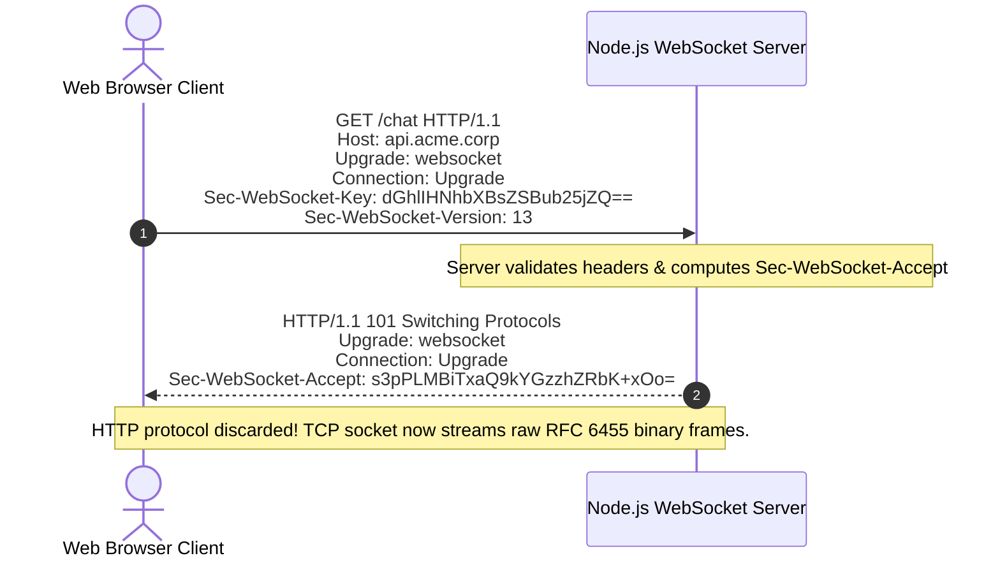

#### Detailed Breakdown of Handshake Headers
| Header | Origin | Specification Purpose |
| :--- | :--- | :--- |
| `Upgrade: websocket` | Client | Signals intention to transition protocol away from HTTP |
| `Connection: Upgrade` | Client & Server | Instructs intermediary proxies not to close the connection |
| `Sec-WebSocket-Key` | Client | Random 16-byte base64-encoded nonce preventing caching proxy collisions |
| `Sec-WebSocket-Version` | Client | Identifies protocol specification version (Must be `13`) |
| `Sec-WebSocket-Accept` | Server | Cryptographic hash proving server understands RFC 6455 |

### 1.4 Cryptographic Handshake Verification: SHA-1 & `Sec-WebSocket-Accept`
To ensure that an HTTP caching proxy or non-WebSocket server does not accidentally accept the upgrade, RFC 6455 requires the server to perform a standardized cryptographic operation:

$$	ext{AcceptKey} = 	ext{Base64}\Big(	ext{SHA-1}ig(	ext{Sec-WebSocket-Key} + 	ext{"258EAFA5-E914-47DA-95CA-C5AB0DC85B11"}ig)\Big)$$

The GUID `"258EAFA5-E914-47DA-95CA-C5AB0DC85B11"` is a globally unique magic constant defined by the IETF RFC 6455 specification.

#### Reference Implementation in Node.js
```javascript
import crypto from 'node:crypto';

export function generateAcceptKey(clientKey) {
  const MAGIC_GUID = '258EAFA5-E914-47DA-95CA-C5AB0DC85B11';
  return crypto
    .createHash('sha1')
    .update(clientKey + MAGIC_GUID)
    .digest('base64');
}

// Example Test Case from RFC 6455:
// Client Key: "dGhlIHNhbXBsZSBub25jZQ=="
// Generated Accept: "s3pPLMBiTxaQ9kYGzzhZRbK+xOo="
```

---

## 2. Stage 2: RFC 6455 Framing & Binary Protocol Wire Mechanics

### 2.1 Anatomy of a WebSocket Frame
Unlike HTTP, which transmits plaintext or gzip-encoded strings, WebSockets transmit data in **binary frames**. A frame header ranges from 2 bytes to 14 bytes in length:

```text
 0                   1                   2                   3
 0 1 2 3 4 5 6 7 8 9 0 1 2 3 4 5 6 7 8 9 0 1 2 3 4 5 6 7 8 9 0 1
+-+-+-+-+-------+-+-------------+-------------------------------+
|F|R|R|R| opcode|M| Payload len |    Extended payload length    |
|I|S|S|S|  (4)  |A|     (7)     |             (16/64)           |
|N|V|V|V|       |S|             |   (if payload len==126/127)   |
| |1|2|3|       |K|             |                               |
+-+-+-+-+-------+-+-------------+ - - - - - - - - - - - - - - - +
|     Extended payload length continued, if payload len == 127  |
+ - - - - - - - - - - - - - - - +-------------------------------+
|                               |Masking-key, if MASK set to 1  |
+-------------------------------+-------------------------------+
| Masking-key (continued)       |          Payload Data         |
+-------------------------------- - - - - - - - - - - - - - - - +
:                     Payload Data continued ...                :
+---------------------------------------------------------------+
```

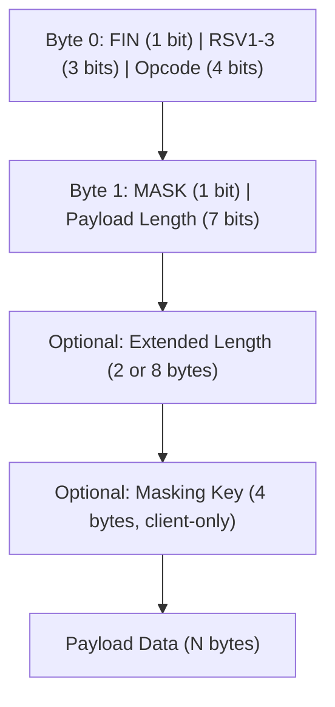

| Field | Size | Architectural Function |
| :--- | :--- | :--- |
| **FIN** | 1 bit | `1` indicates final fragment; `0` indicates more continuation frames follow |
| **RSV1-3** | 3 bits | Reserved for extensions (e.g., `permessage-deflate` compression) |
| **Opcode** | 4 bits | Defines the frame type: Text, Binary, Ping, Pong, Close |
| **MASK** | 1 bit | Mandatory `1` for all client-to-server frames; `0` for server-to-client |
| **Payload Len**| 7 bits | $0	ext{--}125$ bytes directly, `126` indicates 16-bit length, `127` indicates 64-bit length |

### 2.2 Client-to-Server Masking and 4-Byte XOR Bitwise Transformation
To prevent malicious scripts from poisoning intermediate proxy server caches (known as Cache Poisoning Attacks), **every single frame sent from a client to a server MUST be masked with a random 4-byte key**.

The unmasking algorithm applies bitwise XOR $(\oplus)$:

$$	ext{OriginalByte}_i = 	ext{MaskedByte}_i \oplus 	ext{MaskKey}_{i \pmod 4}$$

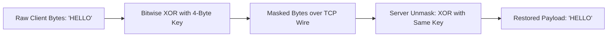

#### Reference Mask/Unmask Implementation
```javascript
export function applyXorMask(payloadBuffer, maskKeyBuffer) {
  const result = Buffer.alloc(payloadBuffer.length);
  for (let i = 0; i < payloadBuffer.length; i++) {
    result[i] = payloadBuffer[i] ^ maskKeyBuffer[i % 4];
  }
  return result;
}
```

### 2.3 Variable Payload Length Encoding (7-bit, 16-bit, 64-bit)
WebSocket frames dynamically scale header size according to payload magnitude:

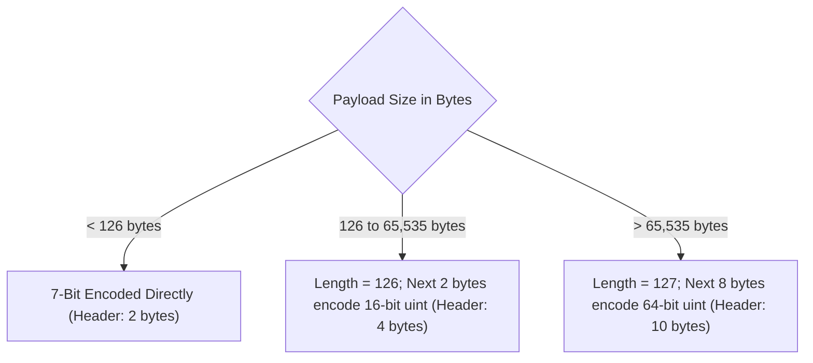

### 2.4 Data Frames vs Control Frames: Fragmentation & Interleaving Rules
RFC 6455 defines two categories of frames:

#### 1. Data Frames
- `0x0`: Continuation Frame (carries additional chunks of a fragmented message).
- `0x1`: Text Frame (UTF-8 encoded string).
- `0x2`: Binary Frame (raw ArrayBuffer, Blob, Protobuf, MessagePack).

#### 2. Control Frames
- `0x8`: Connection Close.
- `0x9`: Ping.
- `0xA`: Pong.

**Crucial Protocol Rules**:
1. Control frames **cannot be fragmented** ($	ext{FIN}=1$ always).
2. Control frames have a maximum payload size of **125 bytes**.
3. Control frames **can be interleaved** in the middle of a fragmented data stream (e.g., a Ping can be injected between Frame 1 and Frame 2 of a 50MB file upload).

---

## 3. Stage 3: Server & Client Architecture: Raw `ws` vs Socket.io

### 3.1 High-Performance Native Node.js `ws` Implementation
The `ws` library is the industry standard for lightweight, zero-dependency, high-throughput WebSocket servers in Node.js.

```typescript
import { WebSocketServer, WebSocket } from 'ws';
import { createServer } from 'node:http';

const server = createServer();
const wss = new WebSocketServer({ noServer: true });

// Handle raw HTTP upgrade
server.on('upgrade', (request, socket, head) => {
  // Validate authentication before completing upgrade
  const authHeader = request.headers['authorization'];
  if (!authHeader || !authHeader.startsWith('Bearer ')) {
    socket.write('HTTP/1.1 401 Unauthorized\r\n\r\n');
    socket.destroy();
    return;
  }

  wss.handleUpgrade(request, socket, head, (ws) => {
    wss.emit('connection', ws, request);
  });
});

wss.on('connection', (ws: WebSocket, req) => {
  console.log('Client connected from IP:', req.socket.remoteAddress);

  ws.on('message', (data, isBinary) => {
    // Broadcast to all active clients
    wss.clients.forEach((client) => {
      if (client !== ws && client.readyState === WebSocket.OPEN) {
        client.send(data, { binary: isBinary });
      }
    });
  });

  ws.on('close', (code, reason) => {
    console.log(`Socket closed: code=${code}, reason=${reason.toString()}`);
  });
});

server.listen(8080, () => console.log('WebSocket server listening on port 8080'));
```

### 3.2 Handshake Authentication & JWT Verification
Authenticating WebSockets requires verifying credentials during the initial HTTP upgrade handshake, before establishing the persistent TCP connection:

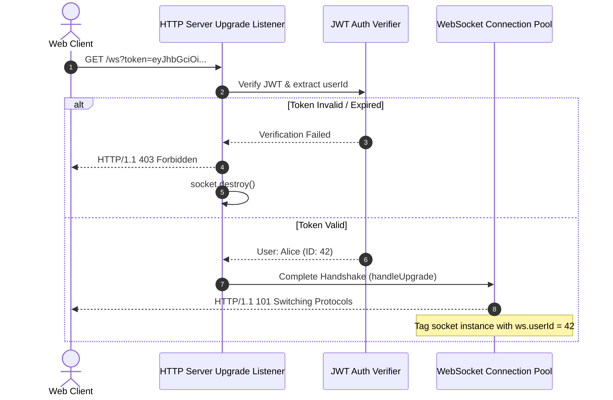

### 3.3 Socket.io Architectural Abstraction: Engine.IO, Rooms, and Namespaces
**Socket.io is NOT a raw WebSocket library**. It is an abstraction framework that provides:
1. **Engine.IO Transport Fallback**: Starts with HTTP long-polling and upgrades to WebSocket if available.
2. **Multiplexed Namespaces**: Logically isolated channels over a single TCP connection (`/chat`, `/notifications`).
3. **Rooms**: Ephemeral broadcasting groups (`socket.join('room_101')`).
4. **Client Acknowledgements**: Request-response RPC emulation (`socket.emit('ping', data, (ack) => { ... })`).

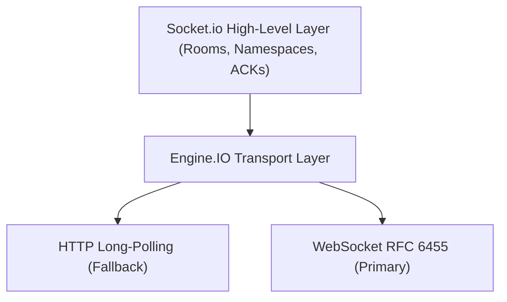

| Feature | Raw WebSockets (`ws`) | Socket.io |
| :--- | :--- | :--- |
| **Protocol** | Pure RFC 6455 standard | Custom binary packet framing |
| **Reconnection** | Requires custom client code | Built-in automatic reconnection |
| **Broadcasting** | Manual loop over `wss.clients` | Native `io.to('room').emit()` |
| **Overhead** | Minimal (~2 bytes per frame) | Additional packet metadata & packet parsing |
| **Ecosystem** | Universal (Go, Rust, Python, Browser) | Client & server must use Socket.io |

### 3.4 Resilient Browser Client Implementation with Modern Web APIs
Below is a production-grade browser WebSocket client featuring connection state management:

```typescript
export class ResilientWebSocketClient {
  private ws: WebSocket | null = null;
  private url: string;
  private isExplicitClose = false;

  constructor(url: string) {
    this.url = url;
  }

  public connect(): void {
    this.isExplicitClose = false;
    this.ws = new WebSocket(this.url);

    this.ws.onopen = () => {
      console.log('Connected to real-time stream');
    };

    this.ws.onmessage = (event: MessageEvent) => {
      console.log('Received payload:', event.data);
    };

    this.ws.onerror = (error) => {
      console.error('WebSocket encountered an error:', error);
    };

    this.ws.onclose = (event: CloseEvent) => {
      if (!this.isExplicitClose) {
        console.warn(`Connection dropped (code=${event.code}). Scheduling reconnect...`);
      }
    };
  }

  public send(data: string | ArrayBuffer): void {
    if (this.ws && this.ws.readyState === WebSocket.OPEN) {
      this.ws.send(data);
    } else {
      console.warn('Cannot send: socket is not in OPEN state');
    }
  }

  public disconnect(): void {
    this.isExplicitClose = true;
    if (this.ws) {
      this.ws.close(1000, 'User initiated disconnect');
    }
  }
}
```

---

## 4. Stage 4: Reliability, Heartbeats & Resilient Reconnection

### 4.1 The Silent Connection Drop: TCP Half-Open State & NAT Timeouts
In real-world mobile and enterprise networks, a client might drive into a tunnel, lose cellular coverage, or experience an aggressive NAT gateway timeout:

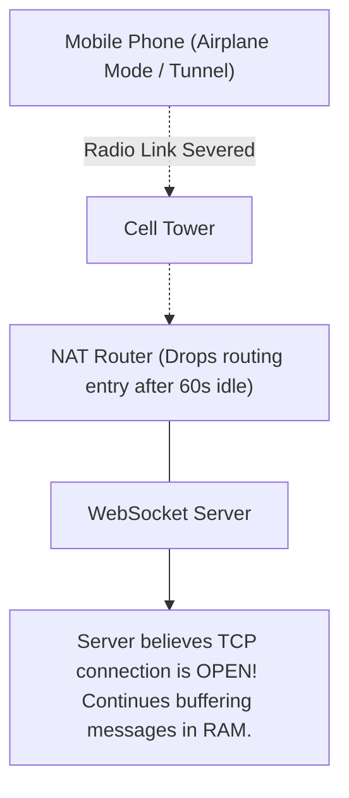

Because no TCP `FIN` or `RST` packet was sent across the severed radio link, the server assumes the socket is still active (**TCP Half-Open State**). Unsent messages accumulate in server memory, leading to Out-Of-Memory (OOM) crashes.

### 4.2 Heartbeat State Machine: Ping/Pong Frame Protocol
To detect dead connections deterministically, implement an active heartbeat ping/pong protocol:

```mermaid
sequenceDiagram
    autonumber
    participant S as Server Heartbeat Loop (Every 30s)
    participant C as Client Socket

    S->>S: Mark client.isAlive = false
    S->>C: Send Ping Frame (Opcode 0x9)
    C-->>S: Return Pong Frame (Opcode 0xA)
    S->>S: Mark client.isAlive = true (Socket Confirmed Healthy)

    Note over S: Next interval (30s later)
    S->>S: Mark client.isAlive = false
    S->>C: Send Ping Frame (Opcode 0x9)
    Note over C: Client loses connection; NO Pong returned
    Note over S: Timer expires; client.isAlive is STILL false!
    S->>S: client.terminate() (Force close socket & free RAM)
```

#### Production Heartbeat Implementation in `ws`
```typescript
function setupHeartbeat(wss: WebSocketServer) {
  const interval = setInterval(() => {
    wss.clients.forEach((ws: any) => {
      if (ws.isAlive === false) {
        console.log('Terminating dead socket due to missing pong');
        return ws.terminate();
      }

      ws.isAlive = false;
      ws.ping(); // Sends RFC 6455 Ping frame
    });
  }, 30000);

  wss.on('close', () => clearInterval(interval));
}
```

### 4.3 Exponential Backoff with Jitter Reconnection Engine
When a server restarts, thousands of clients reconnecting simultaneously cause a **Thundering Herd** crash. Introducing exponential backoff with full randomization (jitter) flattens the connection spike:

$$	ext{Delay} = 	ext{random}(0, \min(	ext{MaxDelay}, 	ext{BaseDelay} 	imes 2^{	ext{attempt}}))$$

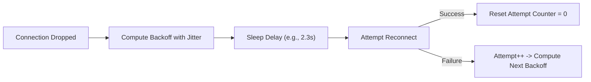

```javascript
export function calculateBackoffWithJitter(attempt, baseDelay = 1000, maxDelay = 30000) {
  const exponential = Math.min(maxDelay, baseDelay * Math.pow(2, attempt));
  // Full jitter: random duration between 0 and exponential ceiling
  return Math.floor(Math.random() * exponential);
}
```

### 4.4 Offline Message Queuing & Sequence Number Reconciliation
To prevent message loss during transient network disconnects:
1. Every message sent by the server includes a monotonically increasing `sequenceNumber` ($1, 2, 3 \dots$).
2. The client records the last sequence number received.
3. Upon reconnection, the client sends a `RESYNC { lastSeq: 42 }` packet.
4. The server replays missed messages from an in-memory or Redis stream buffer.

---


### 4.5 Message Deduplication & Idempotency in Unreliable Networks
When network packets drop or a client reconnects during in-flight deliveries, standard retry logic can cause duplicate message processing (e.g., placing duplicate e-commerce orders or double-crediting balances). Implementing **Idempotent Message Processing** ensures safety:

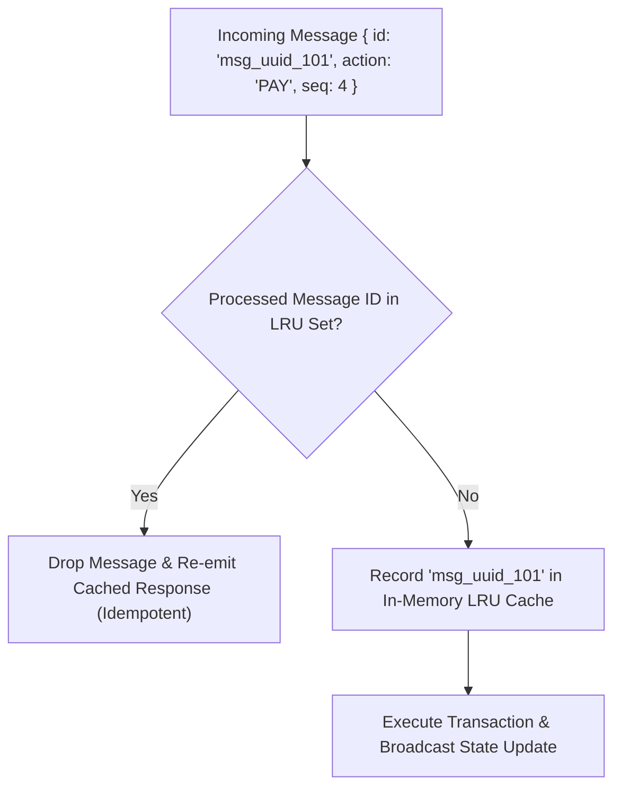

#### Production Sliding Window Deduplication Engine
```javascript
export class MessageDeduplicator {
  constructor(windowSize = 1000) {
    this.windowSize = windowSize;
    this.seenIds = new Set();
    this.orderQueue = [];
  }

  isDuplicate(messageId) {
    if (this.seenIds.has(messageId)) {
      return true;
    }

    this.seenIds.add(messageId);
    this.orderQueue.push(messageId);

    // Evict oldest entries when sliding window capacity is reached
    if (this.orderQueue.length > this.windowSize) {
      const oldestId = this.orderQueue.shift();
      this.seenIds.delete(oldestId);
    }

    return false;
  }
}
```

| Deduplication Strategy | Memory Usage | Replay Window Duration | Best Used For |
| :--- | :--- | :--- | :--- |
| **In-Memory LRU Set** | Low (~50 bytes per ID) | Recent 10,000 messages | High-frequency telemetry & chat |
| **Redis TTL Keys (`SET NX`)** | Moderate (Distributed) | 5 to 60 minutes | Financial orders & payment webhooks |
| **Database Unique Constraints**| High (Disk I/O) | Permanent | Audit logs & irreversible mutations |

## 5. Stage 5: Horizontal Scaling & Distributed State Management

### 5.1 The Single-Server Trap & Multi-Node Cluster Topologies
A single Node.js process cannot handle millions of persistent connections due to CPU single-threading and memory limits. Scaling horizontally across multiple servers introduces the broadcast dilemma:

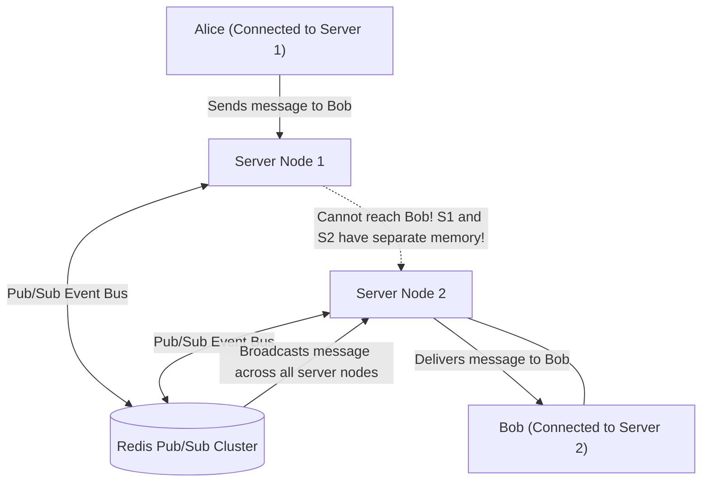

### 5.2 Redis Pub/Sub and Streams Cluster Adapter
By connecting each WebSocket server node to a central Redis pub/sub backplane, any message broadcast on Node 1 is immediately relayed to clients connected to Nodes 2, 3, and 4:

```typescript
import { createClient } from 'redis';

export class DistributedSocketManager {
  private pubClient;
  private subClient;

  constructor(redisUrl: string) {
    this.pubClient = createClient({ url: redisUrl });
    this.subClient = this.pubClient.duplicate();
  }

  async init(onBroadcastReceived: (channel: string, message: string) => void) {
    await this.pubClient.connect();
    await this.subClient.connect();

    // Subscribe to pattern across all chat rooms
    await this.subClient.pSubscribe('room:*', (message, channel) => {
      onBroadcastReceived(channel, message);
    });
  }

  async publishToRoom(roomId: string, message: object) {
    await this.pubClient.publish(`room:${roomId}`, JSON.stringify(message));
  }
}
```

### 5.3 Load Balancing Real-Time Traffic: Sticky Sessions with NGINX & AWS ALB
Because the WebSocket connection begins as an HTTP request and upgrades to TCP, load balancers must maintain session stickiness (affinity) during the upgrade handshake:

#### Production NGINX Reverse Proxy Configuration
```nginx
map $http_upgrade $connection_upgrade {
    default upgrade;
    ''      close;
}

upstream websocket_nodes {
    # Hash on client IP or cookie for session affinity
    ip_hash;
    server 10.0.1.10:8080;
    server 10.0.1.11:8080;
    server 10.0.1.12:8080;
}

server {
    listen 443 ssl http2;
    server_name ws.acme.corp;

    ssl_certificate /etc/ssl/certs/fullchain.pem;
    ssl_certificate_key /etc/ssl/private/privkey.pem;

    location /ws {
        proxy_pass http://websocket_nodes;
        proxy_http_version 1.1;
        proxy_set_header Upgrade $http_upgrade;
        proxy_set_header Connection $connection_upgrade;
        proxy_set_header Host $host;
        proxy_set_header X-Real-IP $remote_addr;

        # Disable proxy buffering for real-time delivery
        proxy_buffering off;

        # Keep idle persistent TCP connections alive for 1 hour
        proxy_read_timeout 3600s;
        proxy_send_timeout 3600s;
    }
}
```

---


### 2.5 Binary Serialization over WebSockets: JSON vs Protocol Buffers vs MessagePack
While JSON is simple and human-readable, high-throughput financial tickers, multiplayer games, and telemetry pipelines waste substantial CPU and bandwidth parsing stringified JSON. Binary protocols serialize data into compact byte buffers:

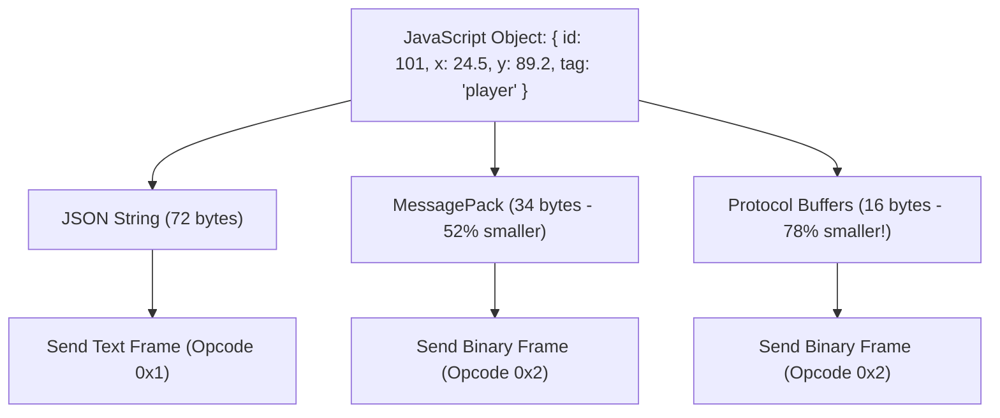

| Serialization Format | Serialized Size | Serialization Speed | Deserialization Speed | Schema Enforcement |
| :--- | :--- | :--- | :--- | :--- |
| **JSON** | 100% (Baseline) | Moderate | Moderate | None (Dynamic) |
| **MessagePack** | ~50% of JSON | 2.5x Faster | 3x Faster | Schema-less binary |
| **Protocol Buffers** | ~25% of JSON | 6x Faster | 8x Faster | Strict `.proto` contract |
| **CBOR** | ~55% of JSON | 2x Faster | 2.5x Faster | Schema-less binary |

#### Packing Binary Payloads in Node.js
```javascript
import { encode, decode } from '@msgpack/msgpack';

// Sending binary frame
function sendBinaryUpdate(ws, telemetry) {
  const binaryBuffer = encode(telemetry);
  ws.send(binaryBuffer, { binary: true }); // Opcode 0x2
}

// Receiving binary frame
function handleBinaryMessage(ws, rawBuffer) {
  const telemetry = decode(rawBuffer);
  console.log('Decoded telemetry position:', telemetry.x, telemetry.y);
}
```

### 3.5 Comprehensive RFC 6455 Close Codes Reference Matrix
RFC 6455 establishes strict guidelines for 2-byte Close status codes sent during the closing handshake:

| Code Range | Standard Definition | Trigger Condition |
| :--- | :--- | :--- |
| `1000` | Normal Closure | Purpose for which connection was opened is fulfilled |
| `1001` | Going Away | Server shutting down or client navigating page |
| `1002` | Protocol Error | Endpoint received an unmasked frame or malformed header |
| `1003` | Unsupported Data | Endpoint received binary when it only accepts text |
| `1005` | No Status Received | Expected status code was omitted (Internal code, not sent on wire) |
| `1006` | Abnormal Closure | Connection dropped abruptly without close handshake (Never sent on wire) |
| `1007` | Invalid Payload | Text frame contained malformed UTF-8 byte sequences |
| `1008` | Policy Violation | Generic code for rate limits or authentication failure |
| `1009` | Message Too Big | Payload exceeds endpoint's configured maximum buffer size |
| `1011` | Internal Error | Server encountered an unhandled exception or crash |
| `4000-4999` | Private / App Codes | Custom application-level business codes (e.g., `4401: Token Expired`) |

### 5.5 Production Kubernetes Deployment Manifest for WebSocket Fleets
Deploying stateful real-time socket workloads on Kubernetes requires custom health probes and graceful termination preStop hooks:

```yaml
apiVersion: apps/v1
kind: Deployment
metadata:
  name: websocket-engine
  namespace: real-time
spec:
  replicas: 10
  strategy:
    type: RollingUpdate
    rollingUpdate:
      maxSurge: 25%
      maxUnavailable: 0 # Zero-downtime rolling update
  template:
    metadata:
      labels:
        app: websocket-engine
    spec:
      terminationGracePeriodSeconds: 90 # Generous drain time for active connections
      containers:
        - name: engine
          image: ghcr.io/acme-corp/ws-engine:v2.1.0
          lifecycle:
            preStop:
              exec:
                command: ["/bin/sh", "-c", "node scripts/graceful-drain.js 60"]
          ports:
            - containerPort: 8080
          readinessProbe:
            httpGet:
              path: /healthz
              port: 8080
            initialDelaySeconds: 5
            periodSeconds: 10
          resources:
            requests:
              cpu: "1000m"
              memory: "2Gi"
            limits:
              cpu: "2000m"
              memory: "4Gi"
```

| Deployment Attribute | Operational Benefit |
| :--- | :--- |
| `maxUnavailable: 0` | Guarantees that replacement pods are fully warm before terminating old pods |
| `terminationGracePeriodSeconds: 90` | Gives existing sockets 90 seconds to finish transactions before SIGKILL |
| `preStop hook` | Sends application-level disconnect notifications to clients before SIGTERM |

## 6. Stage 6: Enterprise Security, Rate Limiting & DoS Mitigation

### 6.1 Cross-Site WebSocket Hijacking (CSWSH) & Origin Validation
Unlike standard cross-origin `fetch()` requests, **browsers do NOT enforce the Same-Origin Policy (SOP) on WebSockets**. A malicious site (`evil.com`) can open a WebSocket to `wss://bank.com/ws`, and the browser will automatically attach the user's authentication cookies!

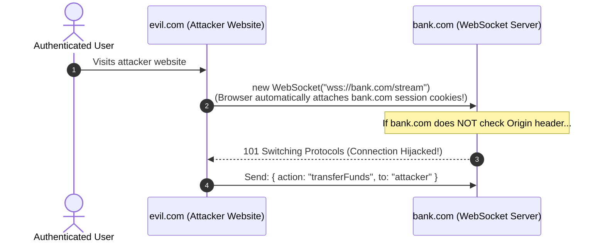

#### Remediation: Strict Origin Verification
```typescript
function verifyOrigin(requestOrigin: string | undefined): boolean {
  const ALLOWED_ORIGINS = ['https://app.bank.com', 'https://bank.com'];
  if (!requestOrigin) return false; // Reject requests with no origin header
  return ALLOWED_ORIGINS.includes(requestOrigin.toLowerCase());
}
```

### 6.2 Token Bucket Rate Limiting per Active Socket
To prevent rogue scripts from flooding the server with hundreds of messages per second, enforce in-memory Token Bucket rate limits per socket:

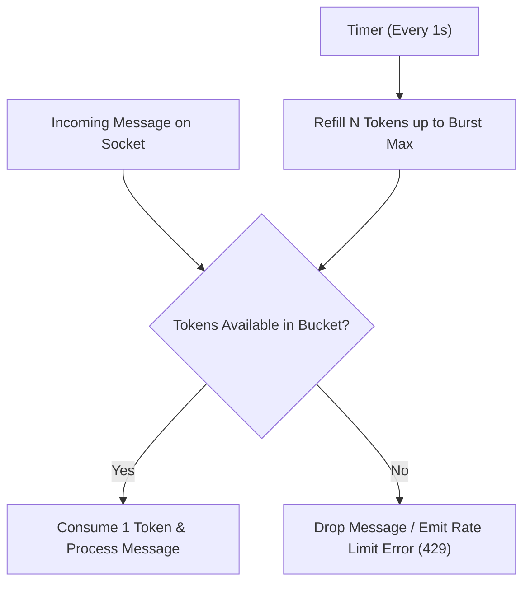

```javascript
export class SocketTokenBucket {
  constructor(capacity = 30, refillRate = 10) {
    this.capacity = capacity;     // Max burst tokens
    this.refillRate = refillRate; // Tokens added per second
    this.tokens = capacity;
    this.lastRefill = Date.now();
  }

  allow() {
    this.refill();
    if (this.tokens >= 1) {
      this.tokens -= 1;
      return true;
    }
    return false;
  }

  refill() {
    const now = Date.now();
    const elapsed = (now - this.lastRefill) / 1000;
    this.tokens = Math.min(this.capacity, this.tokens + elapsed * this.refillRate);
    this.lastRefill = now;
  }
}
```

---


### 6.5 Wireshark Packet Analysis & Troubleshooting Live WebSocket Streams
When debugging dropped connections or invalid frame errors, Wireshark allows engineers to inspect raw TCP bytes and dissect RFC 6455 frames:

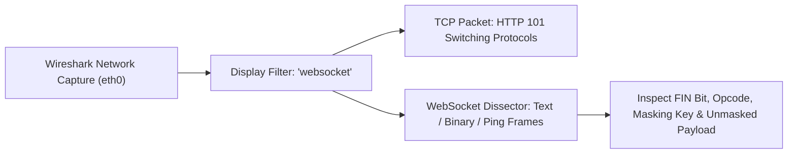

#### Essential Wireshark Display Filters for Real-Time Engineers
```text
# Filter all WebSocket protocol traffic
websocket

# Filter only WebSocket Text frames (Opcode 1)
websocket.opcode == 1

# Filter only WebSocket Binary frames (Opcode 2)
websocket.opcode == 2

# Filter Ping and Pong heartbeat control frames (Opcodes 9 and 10)
websocket.opcode == 9 || websocket.opcode == 10

# Filter connection Close frames (Opcode 8)
websocket.opcode == 8

# Find frames with unmasked payload (server-to-client frames)
websocket.mask == 0
```

| Dissector Field | Protocol Significance | Diagnostic Purpose |
| :--- | :--- | :--- |
| `websocket.fin` | Boolean flag (1 or 0) | Detects whether message fragmentation is functioning properly |
| `websocket.payload_length` | Integer payload size in bytes | Spots buffer explosion or frame flooding anomalies |
| `websocket.mask_key` | 4-byte hexadecimal value | Verifies client compliance with RFC 6455 XOR masking |
| `websocket.close.status_code`| 16-bit unsigned integer | Uncovers exact root cause of socket disconnections (e.g., 1002, 1008) |

### 6.6 High-Throughput I/O Multiplexing: Epoll, Kqueue, and IOCP
At the operating system level, handling hundreds of thousands of concurrent idle sockets without spawning threads requires kernel-level I/O event notification mechanisms:

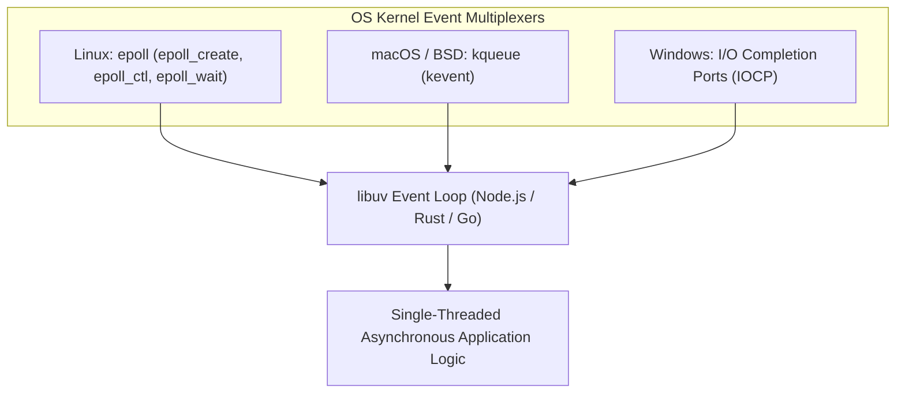

| Multiplexing API | Operating System | Complexity | Performance with 500k Sockets |
| :--- | :--- | :--- | :--- |
| `select()` | Universal POSIX | $O(N)$ linear scan | Degrades catastrophically past 1,024 sockets |
| `poll()` | Universal POSIX | $O(N)$ linear scan | Unusable at scale (high CPU overhead) |
| **`epoll`** | Linux (Ubuntu, RHEL) | $O(1)$ event-driven | Outstanding (near-constant sub-millisecond response) |
| **`kqueue`** | macOS, FreeBSD | $O(1)$ event-driven | Outstanding |
| **`IOCP`** | Windows NT | Overlapped Proactor | Outstanding |

## 7. Stage 7: Staff Real-Time & Network Systems Architect Interview Handbook

### 7.1 High-Stakes Production Outages & Architectural Post-Mortems

#### Scenario A: The Half-Open Socket Memory Leak (C100K Outage)
- **Incident**: A sports streaming platform experienced cascading Out-Of-Memory (OOM) crashes on its Node.js WebSocket fleet during halftime.
- **Root Cause**: Millions of mobile users turned off their phones or switched apps. Because no Ping/Pong heartbeat mechanism was configured, Node.js preserved dead TCP sockets in memory.
- **Remediation**: Implemented a 30-second ping/pong heartbeat interval with `ws.terminate()` for unacknowledged pings, reclaiming 80% of server RAM.

#### Scenario B: The Cross-Site WebSocket Hijacking Breach
- **Incident**: An attacker lured cryptocurrency exchange users to a promotional website that opened silent WebSockets to the exchange, executing unauthorized withdrawals.
- **Remediation**: Enforced strict `Origin` header allowlist validation during the HTTP 101 upgrade handshake and migrated authentication from ambient cookies to explicit short-lived cryptographically signed tokens passed via the query parameter or ticket auth mechanism.

---

### 7.2 25 Exhaustive Technical Interview Questions & Answers

#### Q1: What is the exact sequence of events during an RFC 6455 HTTP upgrade handshake?
> **Answer**:
> 1. The client opens a TCP connection to the server on port 80/443.
> 2. The client sends an HTTP/1.1 GET request with headers `Upgrade: websocket`, `Connection: Upgrade`, and a randomly generated 16-byte base64 nonce in `Sec-WebSocket-Key`.
> 3. The server validates headers, concatenates the key with the magic GUID `"258EAFA5-E914-47DA-95CA-C5AB0DC85B11"`, computes the SHA-1 hash, and encodes it in Base64.
> 4. The server responds with `HTTP/1.1 101 Switching Protocols`, sending the computed hash in `Sec-WebSocket-Accept`.
> 5. Both parties cease HTTP processing; the underlying TCP socket transitions into RFC 6455 binary frame streaming.

#### Q2: Why are client-to-server frames masked while server-to-client frames are unmasked?
> **Answer**:
> Client frames are masked with a random 4-byte XOR key to prevent **Cache Poisoning Attacks** on intermediate proxies. If frames were unmasked, a malicious script on a web page could send crafted HTTP GET request bytes inside a WebSocket payload. An unsuspecting corporate proxy might misinterpret these bytes as a real HTTP request and cache malicious responses for legitimate users. Server frames do not require masking because the server is trusted not to forge malicious proxy requests.

#### Q3: What is the difference between Server-Sent Events (SSE) and WebSockets, and when should you choose SSE?
> **Answer**:
> - **Server-Sent Events (SSE)**: Unidirectional (server-to-client streaming). Runs over standard HTTP/1.1 or HTTP/2. Features built-in reconnection, event IDs, and bypasses corporate firewalls without specialized WebSocket gateways.
> - **WebSockets**: Bidirectional (full-duplex). Ideal for low-latency two-way interactions (multiplayer gaming, collaborative editing).
> - **When to choose SSE**: Choose SSE for dashboards, stock tickers, notification feeds, or AI LLM token streaming where the client only consumes data and does not require high-frequency upstream messaging.

#### Q4: What happens if a client sends an unmasked frame to a compliant RFC 6455 server?
> **Answer**:
> According to RFC 6455 Section 5.1, a server **must immediately close the connection** upon receiving an unmasked frame. The server should send a Close control frame with status code `1002 (Protocol Error)` and terminate the underlying TCP socket.

#### Q5: How do you tune the Linux kernel to support 1,000,000 concurrent WebSocket connections ($C1000K$)?
> **Answer**:
> 1. **File Descriptors**: Increase system-wide and process-level file descriptor limits (`/etc/security/limits.conf` set `nofile 1048576`, and `sysctl -w fs.file-max=2097152`).
> 2. **Ephemeral Ports & Backlog**: Increase TCP listen backlog: `sysctl -w net.core.somaxconn=65535` and `net.ipv4.tcp_max_syn_backlog=65535`.
> 3. **TCP Buffer Memory**: Reduce memory footprint per socket so 1 million sockets do not exhaust RAM: `sysctl -w net.ipv4.tcp_rmem="4096 87380 4194304"` and `net.ipv4.tcp_wmem="4096 65536 4194304"`.
> 4. **Epoll / Event Loop**: Utilize non-blocking I/O event loops (Linux `epoll`, BSD `kqueue`, or Node.js libuv) rather than thread-per-connection architectures.

#### Q6: How does WebSocket compression work via `permessage-deflate`?
> **Answer**:
> During the handshake, client and server negotiate the `Sec-WebSocket-Extensions: permessage-deflate` header. When enabled, payloads are compressed using the Deflate algorithm (DEFLATE standard RFC 1951). The RSV1 bit in the frame header is set to `1` to indicate compressed payload bytes. While it saves network bandwidth for JSON payloads, it incurs significant CPU memory overhead for Deflate sliding window state buffers ($32	ext{KB}$ per active connection).

#### Q7: What are the standard RFC 6455 Close status codes, and what do `1000`, `1001`, and `1006` mean?
> **Answer**:
> - `1000 (Normal Closure)`: The connection successfully completed its purpose.
> - `1001 (Going Away)`: Server shutting down or client navigating away from the web page.
> - `1006 (Abnormal Closure)`: Reserved code. **Never sent over the wire**. Emitted by client libraries when the connection dropped abruptly without receiving a closing handshake frame (e.g., killed process, network cable unplugged).

#### Q8: How does an intermediate proxy (like NGINX or Envoy) maintain a persistent WebSocket connection?
> **Answer**:
> Standard HTTP reverse proxies close connections after sending a response. To support WebSockets, the proxy must maintain **two independent, bonded TCP connections**: one between the client and proxy, and one between the proxy and backend. The proxy configures `proxy_http_version 1.1`, forwards `Upgrade` and `Connection` headers, and disables read timeouts (`proxy_read_timeout 3600s`).

#### Q9: What is the difference between an Opcode of `0x1` and `0x2`?
> **Answer**:
> - `0x1 (Text Frame)`: Payload must contain valid **UTF-8 encoded text**. If an endpoint receives a text frame containing invalid UTF-8 bytes, it must terminate the connection with status code `1007 (Invalid Frame Payload Data)`.
> - `0x2 (Binary Frame)`: Carries raw arbitrary byte buffers (Protobuf, MessagePack, image chunks) with zero validation by the WebSocket protocol engine.

#### Q10: How do you implement zero-downtime rolling deployments for a WebSocket cluster?
> **Answer**:
> 1. Drain connections gracefully: Send a custom application-level event (`{ type: "RECONNECT_DRAIN" }`) to clients on the terminating node.
> 2. Introduce artificial jitter into client reconnect delays to prevent Thundering Herd spikes.
> 3. Use an ALB or Envoy deregistration delay to stop routing new HTTP upgrades to the retiring pod.
> 4. Wait for existing sockets to close (e.g., 60-second grace period) before terminating the process.

#### Q11: Why is storing WebSocket session state in Node.js process memory an anti-pattern?
> **Answer**:
> Storing session state (e.g., user profile, active rooms, permissions) in server process memory prevents horizontal autoscaling. If Node.js restarts or crashes, all connection state is lost. Furthermore, other cluster nodes cannot query or modify that user's state. State must be externalized to Redis or DynamoDB.

#### Q12: What is the C10K problem, and how did WebSockets change it?
> **Answer**:
> The C10K problem (handling 10,000 concurrent connections) plagued legacy multi-threaded web servers (like Apache) that allocated a dedicated thread or process per connection, exhausting OS stack memory. WebSockets combined with event-driven non-blocking I/O engines (Node.js, Go goroutines, Rust Tokio) solved C10K by handling thousands of concurrent idle sockets over a single event loop thread.

#### Q13: How do you handle message ordering guarantees across a distributed WebSocket cluster?
> **Answer**:
> In a distributed multi-node system, messages traversing different network paths can arrive out of order. Assign a monotonically increasing sequence ID or distributed vector clock to every event at ingestion. The client maintains an internal reassembly buffer; if message #4 arrives before message #3, it buffers #4 until #3 is received and processed.

#### Q14: How does WebSockets interact with HTTP/2 and HTTP/3?
> **Answer**:
> Standard WebSockets (RFC 6455) run over HTTP/1.1 TCP. **RFC 8441** defines bootstrapping WebSockets over HTTP/2 using the `CONNECT` method with a `:protocol` pseudo-header, allowing a WebSocket connection to share a multiplexed HTTP/2 TCP stream alongside standard web traffic. Over HTTP/3, WebTransport is the modern successor.

#### Q15: What is the maximum payload size supported by an RFC 6455 WebSocket frame?
> **Answer**:
> When the 7-bit length field is set to `127`, the extended payload length is encoded as a 64-bit unsigned integer, providing a theoretical maximum frame size of $2^{64}-1$ bytes ($pprox 18$ Exabytes). In practice, production servers enforce strict application limits (e.g., 1MB to 10MB) to prevent memory exhaustion DoS attacks.

#### Q16: How do you protect a WebSocket server from Slowloris attacks?
> **Answer**:
> A Slowloris attack opens TCP sockets and transmits handshake headers or frame bytes extremely slowly (e.g., 1 byte every 10 seconds), consuming server connection slots.
> **Remediation**: Enforce strict handshake timeouts (e.g., 5 seconds to complete HTTP upgrade) and minimum byte rate transfer limits on reverse proxies (NGINX `client_body_timeout`).

#### Q17: What is the difference between `socket.terminate()` and `socket.close()` in Node.js `ws`?
> **Answer**:
> - `socket.close([code], [reason])`: Performs a polite, RFC 6455-compliant closing handshake. It sends a Close control frame (Opcode `0x8`) and waits for the peer to respond with a Close frame before closing the underlying TCP socket.
> - `socket.terminate()`: Abruptly destroys the underlying TCP socket immediately (`socket.destroy()`), without sending or waiting for closing handshake frames. Ideal for terminating dead or non-responsive half-open connections.

#### Q18: Can a WebSocket connection be established over HTTPS?
> **Answer**:
> Yes. Secure WebSockets (`wss://`) run over TLS (Transport Layer Security) on port 443. The TLS handshake occurs first; once encrypted communication is established, the HTTP 101 upgrade handshake takes place inside the encrypted TLS tunnel.

#### Q19: What is message fragmentation, and why is it useful?
> **Answer**:
> Message fragmentation allows an endpoint to split a large message across multiple frames. The first frame contains the opcode (`0x1` or `0x2`) with $	ext{FIN}=0$. Subsequent chunks use Continuation frames (`0x0`) with $	ext{FIN}=0$. The final chunk sets $	ext{FIN}=1$. It allows a server to stream large files without knowing the total length in advance and without buffering the entire payload in memory.

#### Q20: How do you implement presence detection (who is online) in a large-scale WebSocket architecture?
> **Answer**:
> Use **Redis Hashes or Sorted Sets with TTLs (Time-To-Live)**:
> 1. When a user connects, set a key in Redis: `SET user:presence:101 "online" EX 60`.
> 2. As long as the socket stays connected, periodically refresh the TTL via heartbeat pings.
> 3. When the socket disconnects explicitly (or TTL expires after a silent drop), publish an `OFFLINE` event via Redis Pub/Sub.

#### Q21: What is the overhead of a WebSocket frame compared to an HTTP/1.1 request?
> **Answer**:
> - **HTTP/1.1**: Each request typically contains 500 to 1,500 bytes of repetitive plaintext headers (`User-Agent`, `Cookie`, `Accept`, `Host`).
> - **WebSocket Frame**: Minimum framing overhead is only **2 bytes** for server-to-client frames and **6 bytes** for client-to-server frames (including the 4-byte mask key).

#### Q22: What happens if a WebSocket server crashes while messages are in-flight?
> **Answer**:
> In-flight TCP packets that reached the OS socket buffer before the crash may be lost if the application process terminates before processing. To achieve guaranteed delivery, implement application-level **Acknowledgements (ACKs)**: the sender retains the message in a local buffer until the recipient replies with an explicit ACK containing the message ID.

#### Q23: Why should you avoid passing JWT access tokens in the WebSocket URL query string?
> **Answer**:
> Query string parameters are recorded in plaintext in reverse proxy access logs (NGINX, CloudFront), browser history, and server diagnostic logs. If a token is in the query string, any log leak compromises user credentials.
> **Alternative**: Use a short-lived, single-use ticket mechanism: exchange the JWT for a random 10-second ticket via POST, then connect to `wss://api.acme.corp/ws?ticket=temp_12345`.

#### Q24: What is the difference between Unicast, Multicast, and Broadcast in real-time systems?
> **Answer**:
> - **Unicast**: Sending a message to a single specific socket connection (e.g., direct message).
> - **Multicast**: Sending a message to a subscribed subset of sockets (e.g., a specific chat room or stock ticker channel).
> - **Broadcast**: Sending a message to every connected socket across the entire server fleet (e.g., global emergency system announcement).

#### Q25: How do you design an end-to-end encrypted (E2EE) real-time messaging protocol over WebSockets?
> **Answer**:
> 1. Use the **Signal Protocol** (Double Ratchet Algorithm with X3DH key agreement).
> 2. The WebSocket server acts strictly as an untrusted blind relay for encrypted binary ciphertext payloads.
> 3. Ephemeral public identity keys are exchanged during session setup.
> 4. Messages are encrypted client-side using Diffie-Hellman derived keys before frame transmission; only the intended recipient possesses the private keys to decrypt the payload.

---

## 8. Community, Contributing & Support

We welcome contributions from real-time systems developers, networking engineers, and open-source architects! Please review our contribution guidelines before submitting pull requests.

### Development Workflow
```bash
# 1. Clone your fork
git clone https://github.com/manthanank/learn-websockets.git

# 2. Run automated test suite
node --test tests/websockets.test.mjs

# 3. Execute WebSocket client validation
node examples/client.mjs
```

- **Contributing Guidelines**: [CONTRIBUTING.md](CONTRIBUTING.md)
- **Code of Conduct**: [CODE_OF_CONDUCT.md](CODE_OF_CONDUCT.md)
- **License**: [MIT License](LICENSE)

---

<div align="center">
  <p>Maintained with precision by <b>Manthan Ank</b>.</p>
  <a href="https://www.buymeacoffee.com/manthanank">
    
  </a>
</div>
